<p align="center">
  
</p>

<h1 align="center">Universal Security Visualization Library</h1>

[](https://opensource.org/licenses/Apache-2.0)
[](https://python.org)
[](https://vuejs.org)
[](https://fastapi.tiangolo.com)

A comprehensive Python library, REST API and web application for creating security visualizations: attack trees, attack graphs, threat models (including MAESTRO for agentic AI), kill chains and MITRE ATT&CK / ATLAS matrices, incident timelines, vulnerability dependency trees, privilege gradients, binary analysis charts, trend charts, custom, Mermaid and cloud architecture diagrams, component diagrams and dependency graphs.

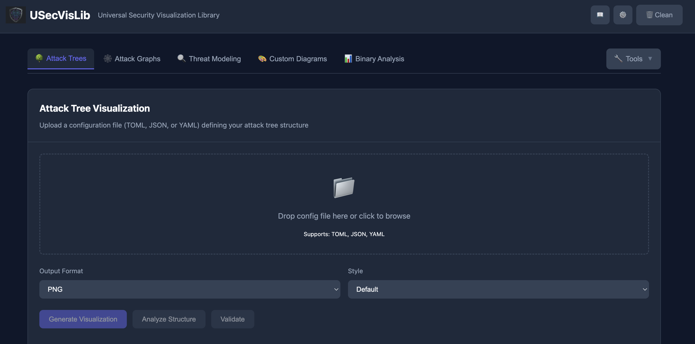

## Features

### Visualization Modules

| Module | Description | Key Features |
|--------|-------------|--------------|
| **Attack Trees** | Hierarchical attack scenario diagrams | AND/OR gates, leaf nodes, CVSS scoring, icons, 23 style presets |
| **Attack Graphs** | Network attack path visualization | Path finding, critical node analysis, CVSS 3.x/4.0 scoring, grouping and collapse by zone or subnet, inferred (hypothesis) steps, "confirmed by N sources" markers, drift between versions, 21 style presets |
| **Threat Modeling** | Data Flow Diagrams with STRIDE analysis | PyTM integration, report generation, trust boundaries, 19 style presets |
| **Custom Diagrams** | Flexible schema-driven diagrams | 100+ shapes, 20+ templates, custom schemas, 14 style presets |
| **Mermaid Diagrams** | Render Mermaid syntax to images | Flowcharts, sequence, class, state, ER, Gantt, pie charts |
| **Cloud Diagrams** | Cloud architecture visualization | AWS, Azure, GCP, Kubernetes icons, clusters, templates |
| **Privilege Gradient** | Trust zone and privilege level visualization | Zone inversion detection, escalation pathways, grouping and collapse, drift with new / fixed / changed inversions, 10 style presets |
| **Component Diagrams** | Software component architecture diagrams | Layered architecture, connection types (sync/async/event), 9 style presets |
| **Dependency Graphs** | Module/package dependency visualization | SLOC-based sizing, circular dependency detection, coupling heat map, 9 style presets |
| **MAESTRO Agentic Threat Models** | Threat modeling for agentic AI systems ([guide](docs/MAESTRO_GUIDE.md)) | 7-layer MAESTRO framework, catalog of 55 threats, 6 cross-layer chains and 93 mitigations, layered / heatmap / agent-graph views, STRIDE / AttackGraph / PrivilegeGradient exports, 10 style presets |
| **Kill Chain / MITRE ATT&CK** | Attack progression through a standardized framework | Cyber Kill Chain / ATT&CK / MITRE ATLAS / custom axes, detection-gap coverage heat, incident paths, Graphviz + SVG engines, 8 style presets |
| **Incident Timeline** | Chronology of a security incident for IR | Swimlane / gantt / vertical / compact modes, severity markers, response-phase bands, MTTD/MTTC/MTTR metrics, ATT&CK tagging, 11 style presets |
| **Vulnerability Dependency Tree** | Software supply-chain / SCA analysis | Dependency tree with CVE annotations, severity heat, exploited-edge highlighting, tree / vulnerable-only / critical-path modes, impact propagation + remediation, 10 style presets |
| **Binary Analysis** | Binary file pattern visualization | Entropy, byte distribution, wind rose, heatmap, byte-pair digraph, 12 style presets |
| **Trend Chart** | Metrics over time (library) | Small multiples on a shared time axis, line / area / step / bar and stacked panels, per-series statistics, 6 style presets |

### Platform Features

- **Two rendering engines** - Graphviz, or the built-in SVG engine (`--render-engine svg`) for attack trees, attack graphs, threat-model DFDs, privilege gradients, component and dependency diagrams, kill chains, timelines, vulnerability trees and the MAESTRO agent graph: crisp output, legends, and `data-*` attributes on every element for interactive use
- **Drift and comparison** - `render_diff()` draws what changed between two versions of an attack graph or privilege gradient (added / removed / modified, new and fixed inversions); `compare_files()` and `compare_series()` diff any module
- **Batch processing** - Render many files at once, from the library, CLI, API or web UI
- **MCP server** - [usecvislib-mcp](https://github.com/vulnex/usecvislib-mcp) exposes the library to AI assistants (65 tools, see [MCP tools](docs/MCP_TOOLS.md))
- **REST API** - FastAPI-based API (100 routes) with OpenAPI documentation
- **Web Frontend** - Vue.js 3 application with dark theme UI ([UI Guide](docs/UI_GUIDE.md))
- **Multi-Format Support** - TOML, JSON, and YAML configuration files
- **Format Conversion** - Convert between configuration formats (including Mermaid export)
- **Mermaid Export** - Export visualizations to Mermaid diagram syntax for docs and wikis
- **Docker Support** - Containerized deployment ready
- **OWASP PyTM Integration** - Industry-standard threat modeling
- **Zoomable Visualizations** - Pan and zoom controls on all images
- **Live Editor** - Syntax highlighting with real-time validation

## Gallery

**[Browse the render gallery →](https://vulnex.github.io/usecvislib-gallery/)**

Every bundled template rendered with every engine (Graphviz, SVG engine, Matplotlib, pytm), every view and every style preset, in PNG, SVG, PDF and DOT. It's the quickest way to pick a preset or compare engines before writing a config. Jump to a module:
[Attack Trees](https://vulnex.github.io/usecvislib-gallery/#attack-trees) ·
[Threat Modeling](https://vulnex.github.io/usecvislib-gallery/#threat-modeling) ·
[Binary Visualization](https://vulnex.github.io/usecvislib-gallery/#binary-visualization) ·
[Attack Graphs](https://vulnex.github.io/usecvislib-gallery/#attack-graphs) ·
[Custom Diagrams](https://vulnex.github.io/usecvislib-gallery/#custom-diagrams) ·
[Cloud Diagrams](https://vulnex.github.io/usecvislib-gallery/#cloud-diagrams) ·
[Mermaid](https://vulnex.github.io/usecvislib-gallery/#mermaid) ·
[Privilege Gradient](https://vulnex.github.io/usecvislib-gallery/#privilege-gradient) ·
[Component Diagram](https://vulnex.github.io/usecvislib-gallery/#component-diagram) ·
[Dependency Graph](https://vulnex.github.io/usecvislib-gallery/#dependency-graph) ·
[Kill Chain](https://vulnex.github.io/usecvislib-gallery/#kill-chain) ·
[Incident Timeline](https://vulnex.github.io/usecvislib-gallery/#incident-timeline) ·
[Vulnerability Tree](https://vulnex.github.io/usecvislib-gallery/#vulnerability-tree) ·
[MAESTRO](https://vulnex.github.io/usecvislib-gallery/#maestro) ·
[Shine Pack](https://vulnex.github.io/usecvislib-gallery/#shine-pack)

The images live in a separate repository, [vulnex/usecvislib-gallery](https://github.com/vulnex/usecvislib-gallery), so they don't add weight to this one. To regenerate them, run `scripts/build_gallery.py` (see the script header).

## Screenshots

### Attack Trees
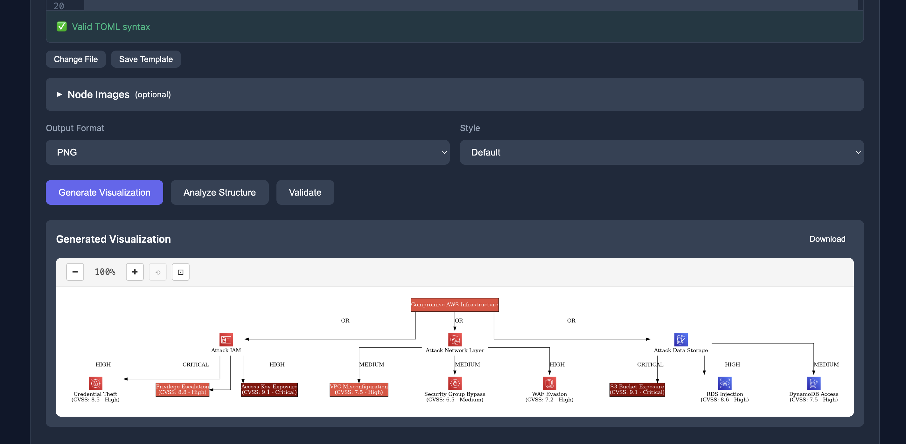

### Attack Graphs
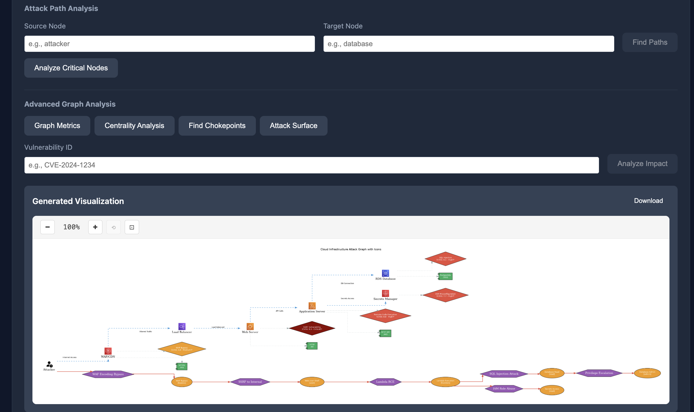

### Threat Modeling
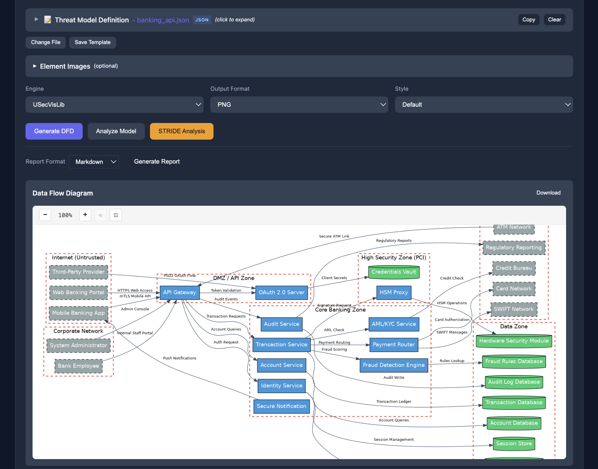

### Custom Diagrams
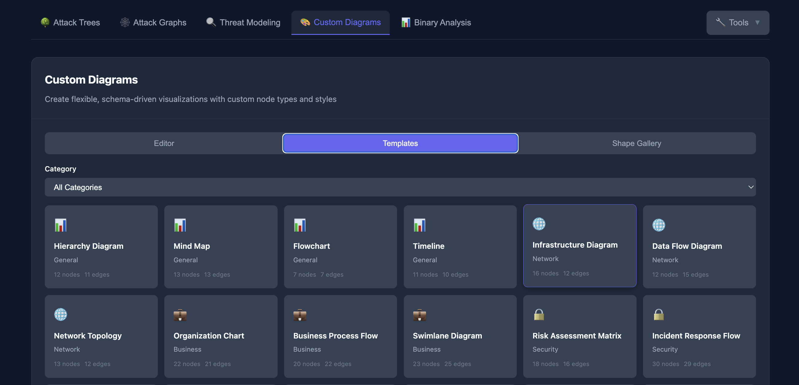

### Mermaid Diagrams
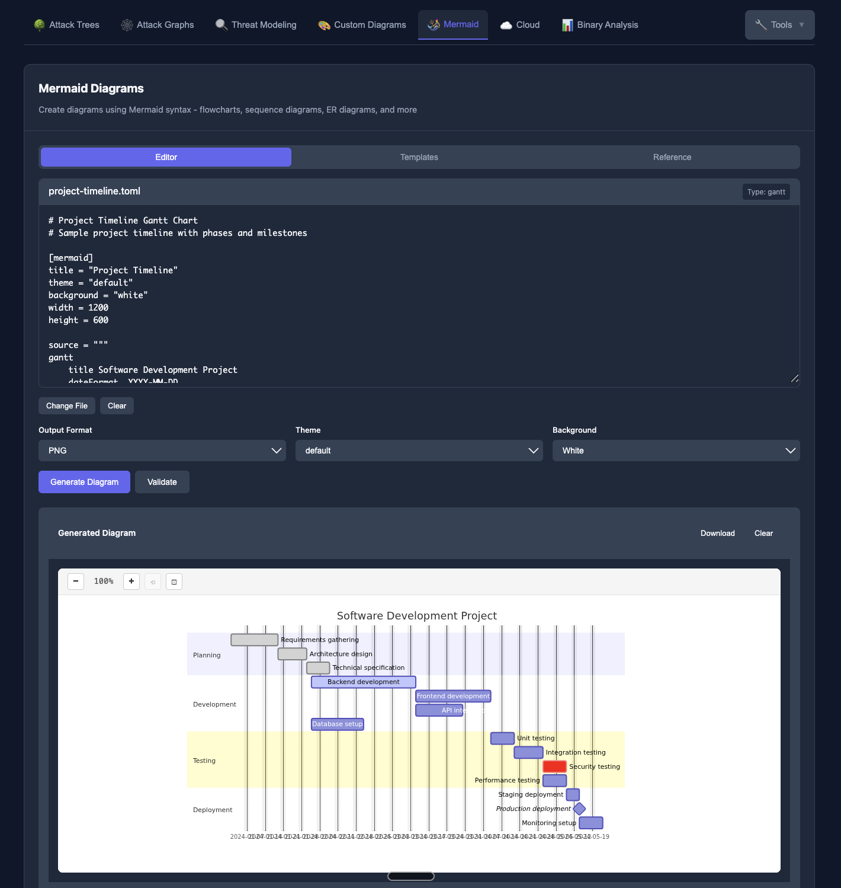

### Cloud Diagrams
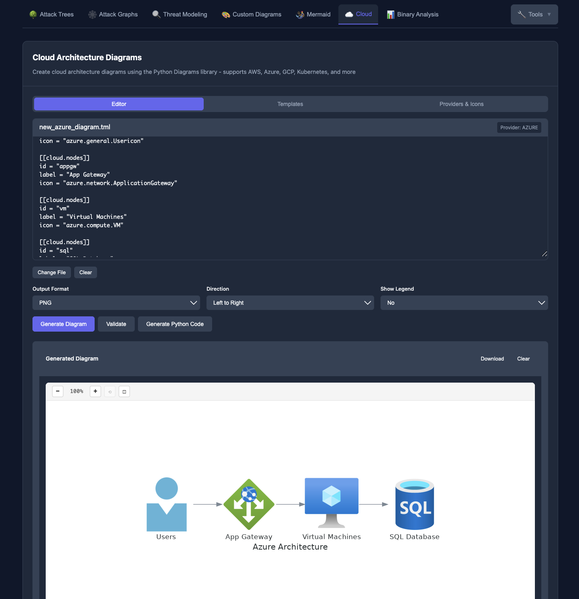

### Privilege Gradient
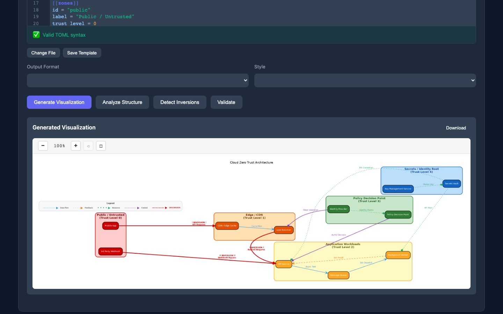

### Architecture (Component Diagrams & Dependency Graphs)
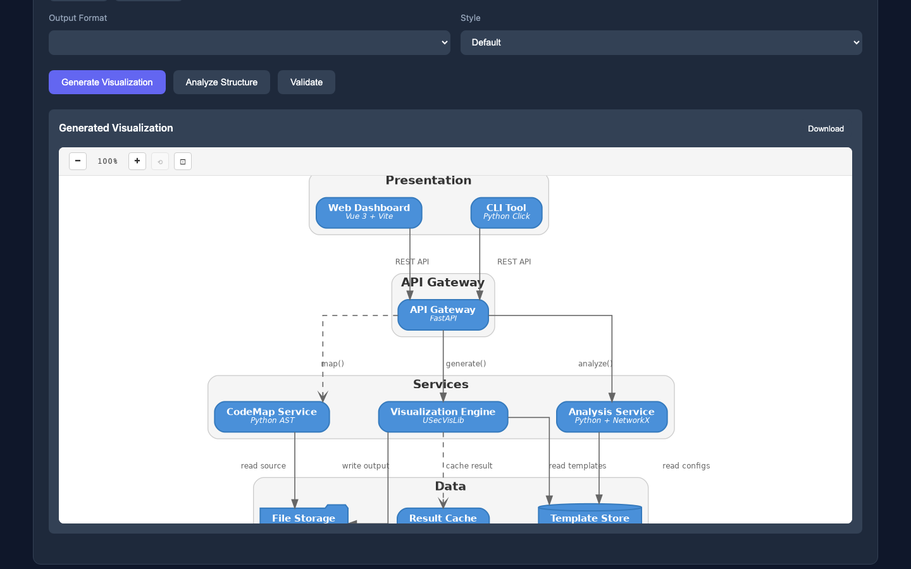

### Binary Analysis
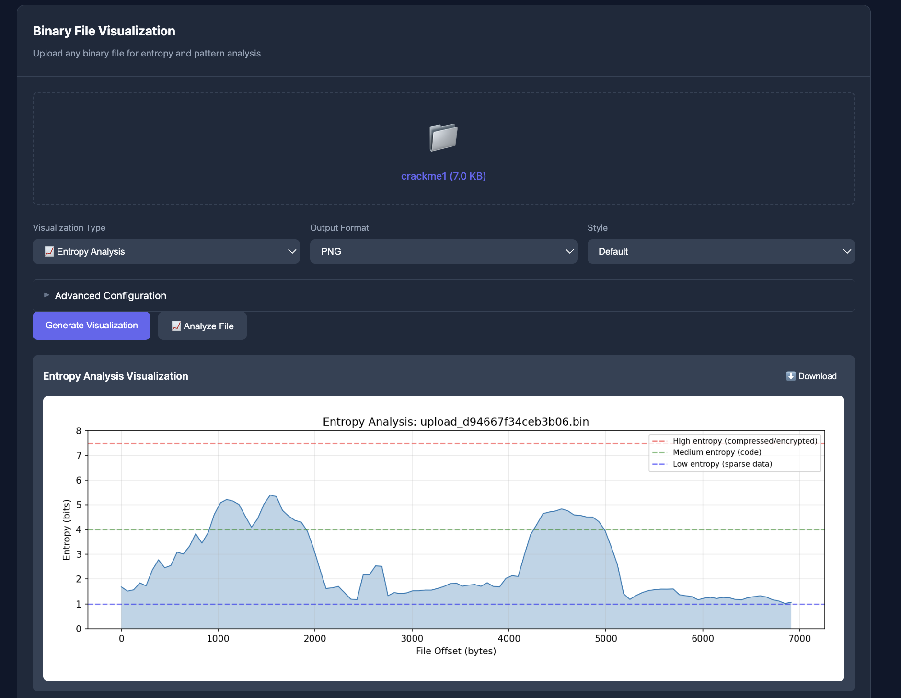

## Web UI Features

The web interface provides an intuitive way to create visualizations:

### Navigation
- **Primary Tabs**: Attack Trees, Attack Graphs, Threat Modeling (with MAESTRO), Kill Chain, Timeline, Vuln Tree, Custom Diagrams, Mermaid, Cloud, Architecture (Component Diagrams & Dependency Graphs), Privilege Gradient, Binary Analysis
- **Tools Menu**: CVSS Calculator, Format Converter, Batch Processing, Data Export, File Compare
- **Header Actions**: Documentation, Settings, Clean/Reset

### Key Features
- Drag-and-drop file upload
- Live code editor with syntax highlighting
- Real-time configuration validation
- Zoomable visualization output; interactive SVG output from the SVG engine
- CVSS display controls (toggle per visualization type)
- Responsive design for mobile devices

See the [UI Guide](docs/UI_GUIDE.md) for detailed documentation.

For Custom Diagrams, see the [Custom Diagrams Guide](docs/CUSTOM_DIAGRAMS_GUIDE.md). For CLI usage, see the [CLI Guide](docs/CLI_GUIDE.md). For the Python library API, see the [Python API Reference](docs/PYTHON_API.md).

## Installation

### Quick Start with Docker

```bash
# Clone the repository (with submodules for Bootstrap icons)
git clone --recursive https://github.com/vulnex/usecvislib.git
cd usecvislib

# If you already cloned without --recursive, initialize submodules:
# git submodule update --init --recursive

# Start with Docker Compose (API + web UI)
docker-compose up -d

# Access the web UI at http://localhost:3001
# API documentation at http://localhost:8003/docs

# Optional: also start the MCP server (requires the usecvislib-mcp
# sibling repo checked out at ../usecvislib-mcp):
#   git clone https://github.com/vulnex/usecvislib-mcp.git ../usecvislib-mcp
#   docker-compose --profile mcp up -d
```

### Manual Installation

```bash
# Clone the repository (with submodules for Bootstrap icons)
git clone --recursive https://github.com/vulnex/usecvislib.git
cd usecvislib

# If you already cloned without --recursive, initialize submodules:
# git submodule update --init --recursive

# Create virtual environment
python -m venv venv
source venv/bin/activate  # On Windows: venv\Scripts\activate

# Install Python dependencies
pip install -r requirements.txt

# Install the package
pip install -e .

# Install frontend dependencies
cd frontend
npm install
cd ..
```

### System Requirements

- Python 3.10+
- Node.js 18+ (for frontend)
- Graphviz (for graph rendering)

```bash
# macOS
brew install graphviz

# Ubuntu/Debian
sudo apt-get install graphviz

# Windows
choco install graphviz
```

### Optional: OWASP PyTM

For advanced threat modeling with PyTM integration:

```bash
pip install pytm
```

## Usage

### Web Application

```bash
# Start the API server
cd api
uvicorn main:app --reload --port 8000

# In another terminal, start the frontend
cd frontend
npm run dev

# Open http://localhost:3000 in your browser
```

### Command Line Interface

```bash
# Attack Tree
usecvis -m 0 -i config.toml -o output -f png -s at_default

# Attack Graph
usecvis -m 3 -i network.toml -o graph -f png -s ag_security

# Threat Model with STRIDE report
usecvis -m 1 -i threat.toml -o diagram -f png -r

# Binary Analysis (all visualizations)
usecvis -m 2 -i binary.exe -o analysis -v all

# Mermaid and cloud diagrams
usecvis -m 4 -i flowchart.toml -o output -f png -t dark
usecvis -m 5 -i architecture.toml -o output -f png -d LR

# Privilege Gradient Graph
usecvis -m 6 -i gradient.toml -o output -f png -s pg_default

# Component Diagram
usecvis -m 7 -i components.toml -o output -f png -s cd_default

# Dependency Graph
usecvis -m 8 -i dependencies.toml -o output -f png -s dg_default

# Kill Chain, Incident Timeline, Vulnerability Tree, MAESTRO
usecvis -m 9 -i apt.tml -o killchain -f png
usecvis -m 10 -i incident.tml -o timeline -f png -v swimlane
usecvis -m 11 -i deps.tml -o vulntree -f png -v critical_path
usecvis -m 12 -i agents.toml -o maestro -f png -v layered

# The SVG engine (any sv_* preset)
usecvis -m 3 -i network.toml -o graph -f svg --render-engine svg -s sv_dark

# Drift between two versions (attack graphs, privilege gradients)
usecvis -m 3 -i week2.tml --diff week1.tml -o drift -f png --changes-only

# Group a large attack graph by zone and collapse it
usecvis -m 3 -i scan.toml -o graph -f png --group-by zone --collapse auto

# Format Conversion (including Mermaid export)
usecvis -i attack.toml -o output --convert json
usecvis -i threat.yaml -o diagram --convert mermaid
```

Custom diagrams have no CLI mode: use the Python API, the REST API or the web UI. Every option is described in the [CLI Guide](docs/CLI_GUIDE.md).

### Python API

```python
from usecvislib import (AttackTrees, AttackGraphs, ThreatModeling, BinVis,
                        CustomDiagrams, PrivilegeGradient, ComponentDiagram,
                        DependencyGraph)

# Attack Trees
at = AttackTrees("attack.toml", "output", format="png", styleid="at_neon")
at.BuildAttackTree()
stats = at.get_tree_stats()

# Attack Graphs
ag = AttackGraphs("network.toml", "graph", format="png", styleid="ag_security")
ag.BuildAttackGraph()
paths = ag.find_attack_paths("attacker", "database_root")
critical = ag.analyze_critical_nodes(top_n=5)

# Threat Modeling
tm = ThreatModeling("threat.toml", "dfd", format="png", engine="pytm")
tm.BuildThreatModel()
threats = tm.analyze_stride()
tm.generate_stride_report("report.md")

# Binary Visualization
bv = BinVis("binary.exe", "analysis", format="png")
bv.BuildBinVis("all")
stats = bv.get_file_stats()

# Custom Diagrams
cd = CustomDiagrams()
cd.load("diagram.toml")
result = cd.BuildCustomDiagram(output="diagram", output_format="png")
stats = cd.get_stats()

# Privilege Gradient
pg = PrivilegeGradient("gradient.toml", "output", format="png", styleid="pg_default")
pg.build()

# Component Diagram
comp = ComponentDiagram("components.toml", "output", format="png", styleid="cd_default")
comp.build()

# Dependency Graph
dg = DependencyGraph("dependencies.toml", "output", format="png", styleid="dg_default")
dg.build()

# Kill Chain, Incident Timeline, Vulnerability Tree, MAESTRO
from usecvislib import IncidentTimeline, KillChain, MaestroThreatModel, VulnDependencyTree

KillChain("apt.tml", "killchain", format="png").build()
IncidentTimeline("incident.tml", "timeline", format="png").build()
VulnDependencyTree("deps.tml", "vulntree", format="png", mode="critical_path").build()
MaestroThreatModel("agents.toml", "maestro", format="png", view="graph", render_engine="svg").build()

# Drift between two versions, drawn as one image
from usecvislib import render_diff

result = render_diff("week1.tml", "week2.tml", "attack_graph", output="drift", format="svg")
print(result.summary)

# Trend chart (metrics over time)
from usecvislib import TrendChart

TrendChart("engagement_metrics.toml", "trend", format="png").build()

# Mermaid Diagrams (render Mermaid syntax to images)
from usecvislib import MermaidDiagrams

md = MermaidDiagrams()
md.load("flowchart.mmd")  # or load from TOML/JSON/YAML config
result = md.render("output", format="png", theme="default")

# Cloud Architecture Diagrams
from usecvislib import CloudDiagrams

cloud = CloudDiagrams()
cloud.load("architecture.toml")
result = cloud.render("output", format="png")

# Mermaid Export (convert existing visualizations to Mermaid syntax)
from usecvislib import serialize_to_mermaid, detect_visualization_type
from usecvislib.utils import ReadConfigFile

config = ReadConfigFile("attack.toml")
vis_type = detect_visualization_type(config)
mermaid_text = serialize_to_mermaid(config, diagram_type=vis_type)
```

## Configuration Formats

All modules support TOML, JSON, and YAML configuration files. Format is auto-detected from file extension.

### Attack Tree Example (TOML)

```toml
[tree]
name = "Web Application Attack"
root = "Compromise App"
params = { rankdir = "TB" }

[nodes]
"Compromise App" = { style = "filled", fillcolor = "red" }
"SQL Injection" = { style = "filled", fillcolor = "orange" }
"XSS Attack" = { style = "filled", fillcolor = "orange" }

[edges]
"Compromise App" = [
  { to = "SQL Injection", label = "OR" },
  { to = "XSS Attack", label = "OR" }
]
```

### Attack Graph Example (TOML)

```toml
[graph]
name = "Corporate Network"
description = "Attack paths through corporate infrastructure"

[[hosts]]
id = "attacker"
label = "External Attacker"
zone = "external"

[[hosts]]
id = "webserver"
label = "Web Server"
ip = "10.0.1.10"
zone = "dmz"

[[vulnerabilities]]
id = "cve_2024_1234"
label = "CVE-2024-1234"
cvss = 9.8
affected_host = "webserver"

[[exploits]]
id = "exploit_web"
label = "Exploit Web RCE"
vulnerability = "cve_2024_1234"
precondition = "attacker"
postcondition = "web_shell"
```

### Threat Model Example (TOML)

```toml
[model]
name = "E-Commerce Platform"
description = "Online shopping system"

[externals.customer]
label = "Customer"

[processes.webserver]
label = "Web Server"
authenticatesSource = true
sanitizesInput = true

[datastores.userdb]
label = "User Database"
isEncrypted = true
isSQL = true

[dataflows.login]
from = "customer"
to = "webserver"
label = "HTTPS Login"
isEncrypted = true

[boundaries.dmz]
label = "DMZ"
elements = ["webserver"]
```

### Custom Diagram Example (TOML)

```toml
[diagram]
title = "System Architecture"
layout = "hierarchical"
direction = "TB"
style = "cd_default"

[schema.nodes.server]
shape = "server"
required_fields = ["name", "ip"]
style = { fillcolor = "#3498DB", fontcolor = "white" }

[schema.nodes.database]
shape = "database"
required_fields = ["name"]
style = { fillcolor = "#27AE60", fontcolor = "white" }

[schema.edges.connection]
style = "solid"
arrowhead = "normal"

[[nodes]]
id = "web"
type = "server"
name = "Web Server"
ip = "10.0.1.10"

[[nodes]]
id = "db"
type = "database"
name = "PostgreSQL"

[[edges]]
from = "web"
to = "db"
type = "connection"
label = "SQL"
```

### Mermaid Diagram Example (TOML)

```toml
[mermaid]
title = "Authentication Flow"
theme = "default"
background = "white"

[mermaid.content]
syntax = """
sequenceDiagram
    participant User
    participant App
    participant Auth
    participant DB

    User->>App: Login Request
    App->>Auth: Validate Credentials
    Auth->>DB: Query User
    DB-->>Auth: User Data
    Auth-->>App: Token
    App-->>User: Session Created
"""
```

Or use raw Mermaid syntax directly:

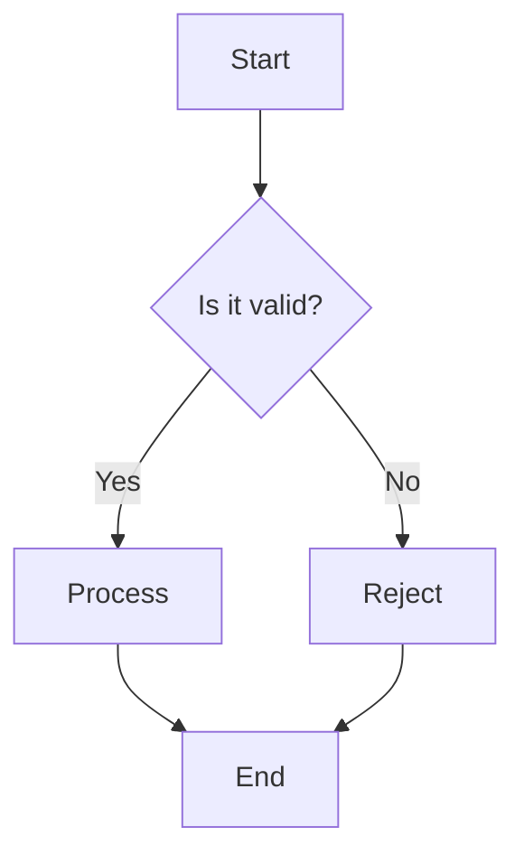

### Cloud Architecture Example (TOML)

```toml
[diagram]
title = "AWS Web Architecture"
direction = "LR"
outformat = "png"

[[clusters]]
id = "vpc"
label = "VPC"

    [[clusters.nodes]]
    id = "alb"
    icon = "aws.network.ElasticLoadBalancing"
    label = "Load Balancer"

    [[clusters.nodes]]
    id = "ec2"
    icon = "aws.compute.EC2"
    label = "Web Server"

[[nodes]]
id = "users"
icon = "aws.general.User"
label = "Users"

[[nodes]]
id = "rds"
icon = "aws.database.RDS"
label = "Database"

[[edges]]
from = "users"
to = "alb"

[[edges]]
from = "alb"
to = "ec2"

[[edges]]
from = "ec2"
to = "rds"
label = "SQL"
```

## Available Styles

Presets prefixed `sv_` belong to the built-in SVG engine (`--render-engine svg`); the others to Graphviz (or Matplotlib for binary, timeline and trend charts). See them all in the [gallery](https://vulnex.github.io/usecvislib-gallery/).

### Attack Trees (23 styles)
`at_default`, `at_white_black`, `at_black_white`, `at_corporate`, `at_neon`, `at_pastel`, `at_forest`, `at_fire`, `at_blueprint`, `at_sunset`, `at_hacker`, `at_minimal`, `at_plain`, `at_nordic`, `at_amethyst`, `at_steel`, `at_glacier`, `at_terra`, `sv_default`, `sv_dark`, `sv_neon`, `sv_corporate`, `sv_minimal`

### Attack Graphs (21 styles)
`ag_default`, `ag_dark`, `ag_security`, `ag_network`, `ag_minimal`, `ag_neon`, `ag_corporate`, `ag_hacker`, `ag_blueprint`, `ag_plain`, `ag_nordic`, `ag_amethyst`, `ag_steel`, `ag_glacier`, `ag_terra`, `ag_doc_light`, `sv_default`, `sv_dark`, `sv_security`, `sv_corporate`, `sv_minimal`

### Threat Models (19 styles)
`tm_default`, `tm_stride`, `tm_dark`, `tm_corporate`, `tm_neon`, `tm_minimal`, `tm_ocean`, `tm_sunset`, `tm_forest`, `tm_blueprint`, `tm_hacker`, `tm_plain`, `tm_doc_light`, `tm_doc_clean`, `sv_default`, `sv_dark`, `sv_security`, `sv_corporate`, `sv_minimal`

### Privilege Gradient (10 styles)
`pg_default`, `pg_dark`, `pg_security`, `pg_neon`, `pg_corporate`, `sv_default`, `sv_dark`, `sv_security`, `sv_corporate`, `sv_minimal`

### Component Diagrams (9 styles)
`cd_default`, `cd_blueprint`, `cd_minimal`, `cd_dark`, `sv_default`, `sv_dark`, `sv_security`, `sv_corporate`, `sv_minimal`

### Dependency Graphs (9 styles)
`dg_default`, `dg_dark`, `dg_minimal`, `dg_coupling`, `sv_default`, `sv_dark`, `sv_security`, `sv_corporate`, `sv_minimal`

### Kill Chain (8 styles)
`kc_default`, `kc_light`, `kc_coverage`, `sv_default`, `sv_dark`, `sv_neon`, `sv_corporate`, `sv_minimal`

### Incident Timeline (11 styles)
`tl_default`, `tl_light`, `tl_dark`, `tl_print`, `tl_minimal`, `tl_corporate`, `sv_default`, `sv_dark`, `sv_print`, `sv_corporate`, `sv_minimal`

### Vulnerability Tree (10 styles)
`vt_default`, `vt_dark`, `vt_security`, `vt_corporate`, `vt_minimal`, `sv_default`, `sv_dark`, `sv_security`, `sv_corporate`, `sv_minimal`

### MAESTRO (10 styles)
`ma_default`, `ma_dark`, `ma_blueprint`, `ma_severity`, `ma_compact`, `sv_default`, `sv_dark`, `sv_security`, `sv_corporate`, `sv_minimal`

### Binary Visualization (12 styles)
`bv_default`, `bv_dark`, `bv_security`, `bv_ocean`, `bv_forest`, `bv_sunset`, `bv_cyber`, `bv_minimal`, `bv_corporate`, `bv_fire`, `bv_purple`, `bv_rainbow`

### Custom Diagrams (14 styles)
`cd_default`, `cd_dark`, `cd_light`, `cd_colorful`, `cd_blueprint`, `cd_sketch`, `cd_corporate`, `cd_neon`, `cd_pastel`, `cd_minimal`, `cd_monochrome`, `cd_security`, `cd_nature`, `cd_ocean`

### Trend Chart (6 styles)
`tr_default`, `tr_light`, `tr_dark`, `tr_print`, `tr_minimal`, `tr_corporate`

## REST API

The FastAPI-based REST API provides programmatic access to all features.

### Endpoints

100 routes in all; the main ones by module (each `visualize` route takes an uploaded file plus `format`, `style` and, where supported, `render_engine`):

| Category | Endpoints |
|----------|-----------|
| **Health** | `GET /health`, `GET /engines`, `GET /formats` |
| **Attack Trees** | `POST /visualize/attack-tree`, `/analyze/attack-tree`, `/validate/attack-tree` |
| **Attack Graphs** | `POST /visualize/attack-graph` (grouping: `group_by`, `collapse`, `max_nodes`), `/analyze/attack-graph`, `/analyze/attack-paths`, `/analyze/critical-nodes`, `/analyze/centrality`, `/analyze/chokepoints`, `/analyze/attack-surface`, `/analyze/vulnerability-impact`, `/analyze/graph-metrics`, `/validate/attack-graph` |
| **Threat Models** | `POST /visualize/threat-model`, `/analyze/threat-model`, `/analyze/stride`, `/report/threat-model`; `GET /threats/library`, `/threats/element-types` |
| **MAESTRO** | `POST /visualize/maestro`, `/analyze/maestro`, `/analyze/maestro/threats`, `/validate/maestro`, `/maestro/export/{target}`; `GET /maestro/catalog`, `/maestro/catalog/{layer}` |
| **Kill Chain** | `POST /visualize/kill-chain`, `/analyze/kill-chain`, `/validate/kill-chain` |
| **Incident Timeline** | `POST /visualize/timeline`, `/analyze/timeline`, `/validate/timeline` |
| **Vulnerability Tree** | `POST /visualize/vuln-tree`, `/analyze/vuln-tree`, `/validate/vuln-tree` |
| **Privilege Gradient** | `POST /visualize/privilege-gradient`, `/analyze/privilege-gradient`, `/analyze/inversions`, `/validate/privilege-gradient` |
| **Architecture** | `POST /visualize/component-diagram`, `/analyze/component-diagram`, `/validate/component-diagram`, `/visualize/dependency-graph`, `/analyze/dependency-graph`, `/validate/dependency-graph` |
| **Binary** | `POST /visualize/binary`, `/analyze/binary` |
| **Custom Diagrams** | `POST /custom-diagrams/visualize`, `/custom-diagrams/validate`, `/custom-diagrams/stats`, `/custom-diagrams/import`, `/custom-diagrams/from-template`; `GET /custom-diagrams/shapes`, `/custom-diagrams/templates`, `/custom-diagrams/layouts`, `/custom-diagrams/styles` |
| **Mermaid** | `POST /visualize/mermaid`, `/analyze/mermaid`; `GET /mermaid/templates`, `/mermaid/template/{category}/{name}`, `/mermaid/themes`, `/mermaid/types` |
| **Cloud** | `POST /visualize/cloud`, `/analyze/cloud`, `/cloud/generate-code`; `GET /cloud/templates`, `/cloud/template/{category}/{name}`, `/cloud/icons`, `/cloud/providers` |
| **Drift and comparison** | `POST /diff/compare`, `/diff/render` (drift picture; summary in `X-Diff-Summary`, inversions in `X-Diff-Inversions`) |
| **Batch, export, convert** | `POST /batch/visualize`, `/export/data`, `/export/sections`, `/convert` |
| **Images and icons** | `POST /images/upload`; `GET /images`, `/images/{image_id}`, `/icons`, `/icons/categories` |
| **Settings and styles** | `GET`/`PUT /settings`, `GET /styles`, `GET /templates`, `GET /progress/{job_id}` |

### API Documentation

Interactive API documentation is available at:
- Swagger UI: `http://localhost:8000/docs`
- ReDoc: `http://localhost:8000/redoc`

## Project Structure

```
usecvislib/
├── src/usecvislib/           # Python library
│   ├── __init__.py           # Package exports
│   ├── usecvis.py            # CLI entry point
│   ├── attacktrees.py        # Attack tree module
│   ├── attackgraphs.py       # Attack graph module
│   ├── threatmodeling.py     # Threat modeling module
│   ├── binvis.py             # Binary visualization module
│   ├── customdiagrams.py     # Custom diagrams module
│   ├── mermaiddiagrams.py    # Mermaid diagram rendering
│   ├── clouddiagrams.py      # Cloud architecture diagrams
│   ├── privilegegradient.py  # Privilege gradient graphs
│   ├── componentdiagram.py   # Component architecture diagrams
│   ├── dependencygraph.py    # Dependency graph visualization
│   ├── killchain.py          # Kill chain / MITRE ATT&CK / ATLAS
│   ├── timeline.py           # Incident timeline
│   ├── vulntree.py           # Vulnerability dependency tree
│   ├── maestro.py            # MAESTRO agentic threat models
│   ├── trend.py              # Trend charts (metrics over time)
│   ├── diff.py, diffrender.py, drift.py  # Comparison and drift pictures
│   ├── grouping.py           # Grouping and collapse
│   ├── registry.py           # Table of modules (CLI modes, keys, classes)
│   ├── batch.py              # Batch processing
│   ├── builders.py           # Builder pattern classes
│   ├── svgengine/            # Built-in SVG rendering engine (painters per module)
│   ├── shapes/               # Shape gallery system
│   ├── schema/               # Schema validation
│   ├── utils.py              # Utility functions
│   └── models/               # Style presets and the MAESTRO threat catalog
├── api/                      # FastAPI REST API
│   ├── main.py               # API application
│   ├── routers/              # Endpoints, one router per module
│   └── schemas.py            # Pydantic models
├── frontend/                 # Vue.js web application
│   ├── src/
│   │   ├── App.vue           # Main application
│   │   ├── components/       # Vue components
│   │   ├── services/         # API services
│   │   └── utils/            # Utilities
│   └── package.json
├── templates/                # Example templates
│   ├── attack-trees/
│   ├── attack-graphs/
│   ├── threat-models/
│   ├── custom-diagrams/
│   ├── mermaid/              # Mermaid diagram templates
│   ├── cloud/                # Cloud architecture templates
│   ├── privilege-gradient/   # Privilege gradient templates
│   ├── architecture/         # Component diagram & dependency graph templates
│   ├── kill-chains/          # Kill chain and ATLAS templates
│   ├── timelines/            # Incident timeline templates
│   ├── vuln-trees/           # Vulnerability dependency tree templates
│   ├── maestro/              # MAESTRO agentic threat model templates
│   ├── drift/                # Two versions each, for drift pictures
│   └── trends/               # Trend chart data
├── scripts/
│   └── build_gallery.py      # Regenerates the render gallery (vulnex/usecvislib-gallery)
├── docs/                     # Guides: CLI, Python API, templates, UI, MAESTRO, MCP tools
├── tests/                    # Test suite (3,200+ tests, byte-exact SVG goldens)
├── docker-compose.yml        # Docker Compose config
├── Dockerfile                # Docker image
├── requirements.txt          # Python dependencies
└── pyproject.toml            # Package metadata & build config
```

## Testing

```bash
# Run all tests
pytest tests/ -v

# Run with coverage
pytest tests/ --cov=usecvislib --cov-report=html

# Run specific module tests
pytest tests/test_attackgraphs.py -v
```

Rendering tests need the Graphviz `dot` binary. The SVG golden files are byte-exact against the Graphviz build in Debian / Ubuntu (the Docker image and CI); with another Graphviz version (e.g. Homebrew) those golden tests fail while the rest pass, so run the suite in the container when they matter.

## Docker Deployment

```bash
# Ensure submodules are initialized (required for Bootstrap icons)
git submodule update --init --recursive

# Copy environment template and configure
cp .env.example .env
# Edit .env to set your API key

# Build and start services
docker-compose up -d

# View logs
docker-compose logs -f

# Stop services
docker-compose down
```

### Environment Variables

| Variable | Default | Description |
|----------|---------|-------------|
| `USECVISLIB_AUTH_ENABLED` | false | Enable/disable API authentication (enable for production!) |
| `USECVISLIB_API_KEY` | (none) | API key for authentication |
| `USECVISLIB_API_KEYS` | (none) | Multiple API keys (comma-separated) |
| `LOG_LEVEL` | INFO | Logging level |
| `ALLOWED_ORIGINS` | localhost:3000,3001 | CORS origins |
| `RATE_LIMIT_VISUALIZE` | 10/minute | Visualization rate limit |
| `RATE_LIMIT_ANALYZE` | 20/minute | Analysis rate limit |
| `API_ROOT_PATH` | "" | API root path for proxies |
| `REQUEST_TIMEOUT_VISUALIZE` / `_ANALYZE` / `_BATCH` | 120 / 60 / 300 | Seconds before a request is abandoned |
| `FORWARDED_ALLOW_IPS` | dashboard proxy | Proxies whose `X-Forwarded-For` is trusted (rate limiting per client) |
| `IMAGE_UPLOAD_DIR` | temp dir | Where uploaded images (for icons) are kept |
| `API_BIND_ADDRESS` | 127.0.0.1 | Docker Compose: the host address the API port (8003) is published on; `0.0.0.0` exposes it to other hosts |

## API Authentication

The API supports optional key-based authentication. **Authentication is disabled by default** for easy setup. For production deployments, enable authentication by setting `USECVISLIB_AUTH_ENABLED=true` and configuring an API key.

When enabled, all endpoints require an `X-API-Key` header.

### Quick Setup

```bash
# Generate an API key
python -c "import secrets; print(f'usecvis_{secrets.token_urlsafe(32)}')"

# Start with authentication
export USECVISLIB_API_KEY=your-generated-key
python -m uvicorn api.main:app --port 8000

# Or disable for local development
USECVISLIB_AUTH_ENABLED=false python -m uvicorn api.main:app
```

### Making Requests

```bash
curl -H "X-API-Key: your-key" http://localhost:8000/health
```

### Frontend Configuration

1. Open Settings (gear icon)
2. Enter your API key in the "API Authentication" section
3. Click "Save API Key"

See [CLI Guide](docs/CLI_GUIDE.md#running-the-rest-api-server) for more details.

## Security Features

- **API Authentication** - Optional API key-based authentication with multiple key support
- **Input Validation** - All user input is sanitized
- **Rate Limiting** - Configurable rate limits per endpoint
- **Security Headers** - CSP, X-Frame-Options, X-Content-Type-Options
- **File Size Limits** - 1MB for configs, 50MB for binaries
- **CORS Protection** - Configurable allowed origins
- **Temp File Cleanup** - Automatic cleanup of temporary files

## Contributing

Contributions are welcome! Please feel free to submit a Pull Request.

1. Fork the repository
2. Create your feature branch (`git checkout -b feature/amazing-feature`)
3. Commit your changes (`git commit -m 'Add amazing feature'`)
4. Push to the branch (`git push origin feature/amazing-feature`)
5. Open a Pull Request

## License

This project is licensed under the Apache License 2.0 - see the [LICENSE](LICENSE) file for details.

## Author

**Simon Roses Femerling** - [VULNEX](https://www.vulnex.com)

## Acknowledgments

### Core Technologies

- [Graphviz](https://graphviz.org/) - Graph visualization software
- [OWASP PyTM](https://github.com/OWASP/pytm) - Threat modeling framework
- [FastAPI](https://fastapi.tiangolo.com/) - Modern web framework
- [Vue.js](https://vuejs.org/) - Progressive JavaScript framework
- [CodeMirror](https://codemirror.net/) - Code editor component
- [NetworkX](https://networkx.org/) - Network analysis library
- [Matplotlib](https://matplotlib.org/) - Plotting library for binary visualization
- [Mermaid-CLI](https://github.com/mermaid-js/mermaid-cli) - Mermaid diagram rendering
- [Diagrams](https://diagrams.mingrammer.com/) - Cloud architecture diagrams as code

### Icon Libraries

We gratefully acknowledge the following icon libraries included in this project:

| Library | Source | License |
|---------|--------|---------|
| **AWS Architecture Icons** | [aws-icons.com](https://aws-icons.com/) | AWS Terms |
| **Azure Architecture Icons** | [Microsoft Learn](https://learn.microsoft.com/en-us/azure/architecture/icons/) | Microsoft Terms |
| **Bootstrap Icons** | [icons.getbootstrap.com](https://icons.getbootstrap.com/) | MIT License |

### Additional Credits

- [smol-toml](https://github.com/squirrelchat/smol-toml) - TOML parser for JavaScript
- [js-yaml](https://github.com/nodeca/js-yaml) - YAML parser for JavaScript
- [Mermaid](https://mermaid.js.org/) - Diagramming and charting tool (export format)

## Projects and Articles

Projects and articles that use or mention USecVisLib:

### Projects

<!-- Add projects here using the format below -->
<!-- - [Project Name](https://link) - Brief description -->

*Know a project using USecVisLib? Submit a PR to add it here!*

### Articles and Tutorials

- [Information Warfare Strategies (SRF-IWS): Offensive Operations at the Davos Forum 2026 (Part 3)](https://simonroses.com/2026/01/information-warfare-strategies-srf-iws-offensive-operations-at-the-davos-forum-2026-part-3/) - Simon Roses (January 2026)

*Written about USecVisLib? Let us know and we'll add your article!*

---

**VULNEX** - Universal Security Visualization Library v0.6.0
